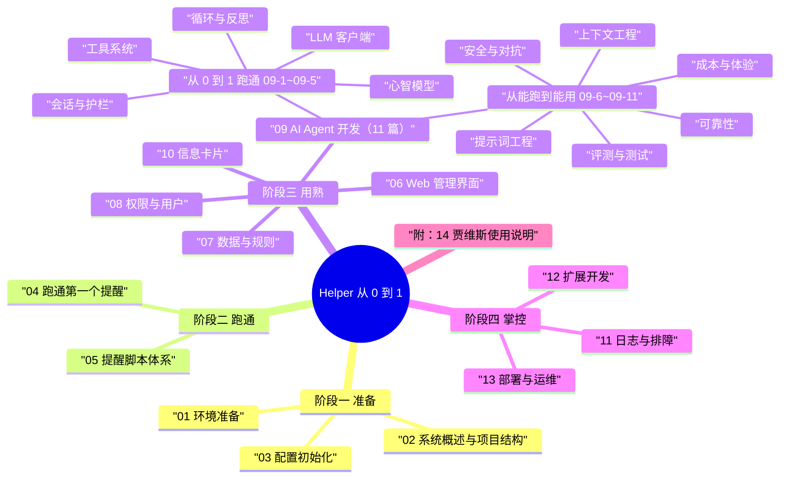

# 从 0 到 1 学 Helper

> 一套面向新手的实操教程：装环境 → 跑通第一条提醒 → 用熟 Web 界面 → 自己加功能 → 上线运维。
> 只讲「怎么做 + 为什么 + 怎么验证」。
> 如果你是开发者、想**自己写一个 AI Agent 应用**，直接看第 09 章 [AI Agent 开发系列](09-1-Agent心智模型.md)：
> 11 篇，覆盖「从 0 到 1 跑通」（09-1~09-5）+「从能跑到能用」（09-6~09-11）两个阶段。

---

## 适合谁

- 刚接手这个项目，想搞清楚「它到底是怎么跑起来的」
- 只想先让提醒跑起来，再慢慢研究细节
- 准备在这个项目上加脚本 / 加页面，需要知道改动的正确姿势

**不需要**你精通 Bash 或 Vue，但默认你会用命令行、能读简单的 shell / TypeScript。

---

## 学习路径思维导图

---

## 章节一览

| 阶段 | 章节 | 学完你能做什么 | 关键产物 |
|------|------|---------------|---------|
| 一 | [01 环境准备](01-环境准备.md) | 装齐依赖、拉起项目 | 依赖就绪、`scripts/` 可执行 |
| 一 | [02 系统概述与项目结构](02-系统概述与项目结构.md) | 系统是什么、由哪几块拼起来 | 脑中有地图 |
| 一 | [03 配置初始化](03-配置初始化.md) | 配好 `web/.env` 与机器人 | 配置可用 |
| 二 | [04 跑通第一个提醒](04-跑通第一个提醒.md) | 手动发出第一条企微消息 | 端到端闭环 |
| 二 | [05 提醒脚本体系](05-提醒脚本体系.md) | 明白谁在什么时候被调起 | 能改时间表 |
| 三 | [06 Web 管理界面](06-Web管理界面.md) | 启动、登录、用各页面 | 日常操作走页面 |
| 三 | [07 数据与规则](07-数据与规则.md) | 管缓存、规则、模板、文案 | 自定义内容 |
| 三 | [08 权限与用户](08-权限与用户.md) | 加人、配角色、审权限 | 多人可用 |
| 三 | [09-1 Agent 心智模型](09-1-Agent心智模型.md) | 知道 Agent 由哪五块组成，跑通首次调用 | 30 行最小实现 |
| 三 | [09-2 LLM 客户端与流式](09-2-LLM客户端与流式.md) | 重试退避、SSE 解析、工具参数流式拼接 | 能上生产的客户端 |
| 三 | [09-3 Agent 工具系统](09-3-Agent工具系统.md) | Tool 抽象、自动注册、权限、consent 护栏 | 会写自己的工具 |
| 三 | [09-4 Agent 循环与反思](09-4-Agent循环与反思.md) | 迭代上限、终止条件、反思节流 | 循环不跑飞 |
| 三 | [09-5 会话·护栏·工程化](09-5-会话护栏与工程化.md) | 持久化、四道防线、可观测性、调优 | 能上线 |
| 三 | [09-6 提示词工程](09-6-提示词工程.md) | 把业务规则稳定灌输给模型 | 软/硬约束分工 |
| 三 | [09-7 上下文工程](09-7-上下文工程.md) | 窗口预算、精简、压缩、RAG 取舍 | 成本与效果可控 |
| 三 | [09-8 结构化输出与可靠性](09-8-结构化输出与可靠性.md) | 解析容错、超时、幂等、降级、中断 | 错得起 |
| 三 | [09-9 安全与对抗](09-9-安全与对抗.md) | 注入面盘点、六道防线、越权、审计 | 知道怎么被攻破才防得住 |
| 三 | [09-10 评测与测试](09-10-评测与测试.md) | 五类指标、三层测试金字塔、回归流程 | 迭代不靠感觉 |
| 三 | [09-11 成本、可观测与前端交互](09-11-成本可观测与前端交互.md) | token 预算、prompt caching、trace、流式 UI | 上线后不痛 |
| 三 | [10 信息卡片](10-信息卡片.md) | 生成卡片、跑卡片脚本 | 出图推送 |
| 四 | [11 日志与排障](11-日志与排障.md) | 定位「为什么没发」 | 会看日志 |
| 四 | [12 扩展开发](12-扩展开发.md) | 加脚本 / 加页面的正确姿势 | 能改代码 |
| 四 | [13 部署与运维](13-部署与运维.md) | 上线、保活、备份、升级 | 稳定跑着 |
| 附 | [14 贾维斯使用说明](14-贾维斯使用说明.md) | 只想知道「怎么用」，不想写代码 | 会用即可 |

---

## 全篇约定

| 约定 | 说明 |
|------|------|
| 命令工作目录 | 除特别说明，均在**项目根目录** `helper/` 下执行 |
| `$HELPER` | 文档里代表项目根目录的绝对路径 |
| 配置文件 | 唯一真相源 `web/.env`（脚本与 Web 共用，见 [03](03-配置初始化.md)） |
| Web 地址 | `http://<机器IP>:9527`，启动器 `3001` |
| 会真发消息的命令 | 文档中用 ⚠️ 标注，调试时先确认机器人指向的群 |

---

## 运维速查卡

| 我要做什么 | 操作 | 详见 |
|------------|------|------|
| 让提醒开始/停止推送 | `daemon.sh start` / `stop` | [05](05-提醒脚本体系.md) |
| 看提醒是不是在跑 | `daemon.sh status`（输出进日志）或「仪表盘」 | [13](13-部署与运维.md) |
| 立刻发一次提醒 | `bash scripts/xxx.sh` 或让贾维斯执行 | [05](05-提醒脚本体系.md)、[14](14-贾维斯使用说明.md) |
| 改天气 Key、生日列表 | 编辑 `web/.env`（**不用**重启脚本） | [03](03-配置初始化.md) |
| 改 SMTP / JWT / LLM | 编辑 `web/.env` → **重启 Web** | [03](03-配置初始化.md) |
| 加企业微信机器人 | Web「系统配置」→「企业微信机器人」 | [03](03-配置初始化.md) |
| Web 打不开 | `start_web.sh restart` → 看 `web/.runtime/web_server.jsonl` | [11](11-日志与排障.md) |
| 看提醒为什么没发 | `view_logs.sh error` | [11](11-日志与排障.md) |
| 年底更新节假日数据 | `annual_update.sh` | [05](05-提醒脚本体系.md) |

---

## 关于 AI 的两套文档（别看错顺序）

| 你是谁 | 看哪个 | 编号 |
|--------|--------|------|
| **开发者**：要从 0 到 1 写一个 AI Agent 应用 | AI Agent 开发系列（11 篇，主教程第 09 章） | `09-1 ~ 09-11` |
| 使用者 / 运维：只想用贾维斯查状态、触发脚本 | 贾维斯使用说明（1 篇，可选） | `14-贾维斯使用说明` |

**建议**：即使你只想"用"，也先读 [09-1 心智模型](09-1-Agent心智模型.md)——不理解 Agent 的循环与护栏，遇到"它为什么不执行"就只能靠猜。

---

## 想抄近路？

| 你的目的 | 最小路径 |
|---------|---------|
| 只想让提醒跑起来 | 01 → 03 → 04 → 13 |
| 只想用 Web 界面 | 01 → 03 → 06 |
| 要加一个新提醒 | 01 → 02 → 05 → 12 |
| 要加一个新页面 | 02 → 06 → 12 |
| 只想用贾维斯（不写代码） | 14 |
| 要自己写一个 AI Agent | 09-1 → 09-2 → 09-3 → 09-4 → 09-5（跑通）→ 09-6 ~ 09-11（生产化） |
| 只想知道改了 prompt 会不会变差 | 09-6 → 09-10 |

---

**返回**: [主文档](../README.md)  [下一篇：环境准备](01-环境准备.md)
