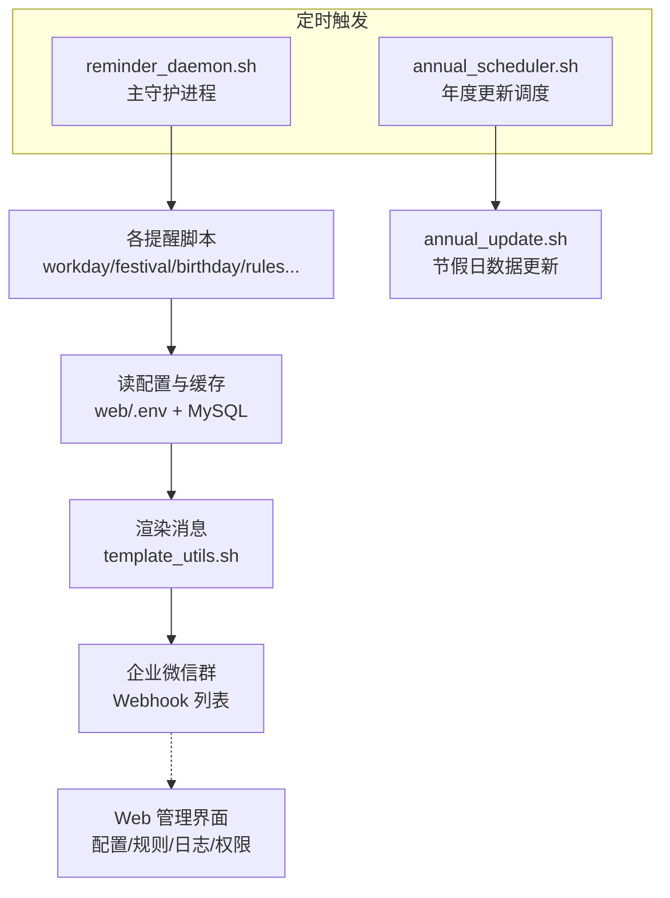
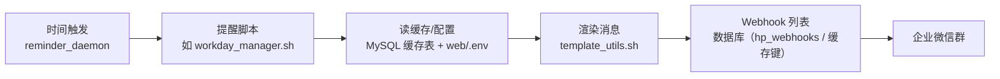

# 02 系统概述与项目结构

**目标**：知道这个系统是什么、由哪几块拼起来，后面改东西知道去哪找。

---

## 1. 这是什么

基于企业微信机器人的智能提醒系统：**Bash 脚本负责定时把消息推到企业微信，Web 管理界面让人不用改代码也能配置**。当前版本 v3.x。

| 核心能力 | 说明 |
|---------|------|
| 工作日提醒 | 早安（含天气/历史/黄历/星座）、午餐、下班，支持调休 |
| 节日祝福 | 公历/农历/节气/特殊节日，优先级调度 |
| 生日提醒 | 公历 + 农历（`lunar:MM-DD`），支持提前提醒 |
| 周期提醒 | 周五总结、月度提醒、假期倒计时 |
| 自定义规则 | 不写代码，Web 界面配置任意时间的提醒 |
| 数据缓存 | 凌晨预获取，早晨高峰直接读缓存（0.1s vs 2-5s） |
| Web 管理界面 | 配置、规则、模板、日志、缓存、RBAC、AI 助手 |

### 技术栈

| 层 | 技术 |
|----|------|
| 提醒引擎 | Bash 4+ / Python 3.6+（lunar-python 农历互转） |
| Web 后端 | Node.js 16+ / Express / TypeScript（ts-node） |
| Web 前端 | Vue 3 + Vite + TDesign |
| 数据 | MySQL / MariaDB 是缓存与配置的唯一真源（`hp_*` 表、`hp_cache_res_*` 分类表与按缓存键展开的已有业务表，`sql/` 建表与种子，Web「数据库管理」页管理）；Web 经 `web/utils/database/cache-store.ts`、shell 经 `scripts/cache_db.sh` 按缓存键读写，运行时零文件依赖、不再有 `.cache/` 缓存文件，也没有文件 mtime 同步或降级快照；`docs/` + `knowledge/` 的 Markdown 全文入 `hp_knowledge_docs`，系统文档按正文 hash 回灌、库为知识库运行时真源 |
| 卡片渲染 | SVG → rsvg-convert → PNG |

---

## 2. 一句话架构

```
scripts/  提醒引擎（Bash）—— 定时把消息推到企业微信
web/      管理界面（Express + Vue 3）—— 让人不用改代码也能配置
MySQL    缓存 / 配置唯一真源 —— Web 与 shell 按缓存键读写，运行时零文件依赖
```



三者关系：**脚本读配置与缓存 → 渲染消息 → 调 Webhook 推送**；**Web 写缓存与配置 → 反过来影响脚本行为**。两边通过 MySQL 缓存表与 `web/.env` 共享数据，运行时不再读写 `.cache/` 文件。

---

## 3. 顶层目录

```
helper/
├── scripts/                 # 提醒脚本（核心业务，120+ 个 .sh）
│   ├── daemon.sh            # 守护进程总开关
│   ├── reminder_daemon.sh   # 主守护进程：按时间调起各提醒
│   ├── workday_manager.sh   # 工作日提醒（早安/午餐/下班）
│   ├── festival_greetings.sh# 节日祝福
│   ├── birthday_reminder.sh # 生日提醒
│   ├── daily_data_manager.sh# 数据预获取与缓存
│   ├── view_logs.sh         # 日志查看
│   ├── start_web.sh         # Web 服务启停
│   ├── tools/               # 信息卡片脚本（输出 PNG）
│   └── update-tools/        # 年度更新子工具
├── web/                     # Web 管理界面
│   ├── server.ts            # 后端入口（:9527）
│   ├── web-launcher.ts      # 启动器（:3001，用于远程拉起主服务）
│   ├── routes/              # 后端路由
│   ├── utils/               # 后端工具（按模块分子目录）
│   ├── types/               # 后端类型与常量
│   ├── public/              # 前端构建产物（生产模式直接托管）
│   └── frontend/            # Vue 3 前端源码
├── .cache/                  # 已移除：缓存数据全量入库，运行时不再产生文件
├── docs/                    # 文档（教程 + 附录）
├── sql/                     # 模块化建表 SQL（按业务模块分目录）
└── helper_database.sql      # 初始化入口（SOURCE 聚合 sql/ 下脚本）
```

---

## 4. 必须认识的几个文件

| 文件 | 作用 | 什么时候会碰它 |
|------|------|---------------|
| `scripts/project_config.sh` | 推导 `PROJECT_DIR` / `ROOT_DIR` / `ENV_FILE` | 写新脚本第一行就 source 它 |
| `scripts/weather_config.sh` | 加载 `.env`、时区、Webhook 与 `send_wecom_message` | 需要发消息或读配置时 |
| `scripts/log_utils.sh` | 统一日志（`log_info` 等，stderr + 写入 `hp_run_logs`） | 写脚本要打日志时 |
| `scripts/holiday_config.sh` | 节假日/调休判断（`is_holiday` 等） | 需要判断工作日时 |
| `web/server.ts` | 后端入口：加载 `.env` → 注册路由 → 监听 9527 | 加新 API 时 |
| `web/routes/utils.ts` | 后端 barrel，统一对外导出 | 加新 utils 后要在这里导出 |
| `web/frontend/src/router/index.ts` | 前端路由与菜单 | 加新页面时 |

---

## 5. 运行时会有哪些进程

| 进程 | 启动方式 | 端口 | PID / 日志 |
|------|---------|------|-----------|
| 主提醒守护进程 | `bash scripts/daemon.sh start` | — | `scripts/reminder_daemon.pid` / `hp_run_logs(reminder_daemon)` |
| 年度调度器 | 同上（一起拉起） | — | `scripts/annual_scheduler.pid` / `hp_run_logs(annual_scheduler)` |
| Web 服务 | `bash scripts/start_web.sh start` | 9527 | `web/.runtime/web.pid` / `hp_run_logs(web_server)` |
| Web 启动器 | 同上（一起拉起） | 3001 | `web/.runtime/launcher.pid` / `hp_run_logs(web_launcher)` |

> 日志统一入库，不再产生 `*.log` / `*.jsonl` 文件；PID 文件仍保留在各自目录。

---

## 6. 一条消息是怎么发出去的



理解这条链，后面排查「为什么没发」就只需逐段验证：时间到了没 → 脚本跑了没 → 数据取到没 → Webhook 配了没。

---

## 7. 文档地图

| 想了解 | 看哪篇 |
|--------|--------|
| 快速上手 | 本教程 [00 导航](00-导航.md) 起 |
| 配置字段全清单 | [03 配置初始化](03-配置初始化.md) |
| AI Agent 开发（从 0 到 1） | [AI Agent 开发系列](09-1-Agent心智模型.md) |

---

## 8. 建议的源码阅读顺序

1. `scripts/reminder_daemon.sh`：看调度主循环（几分钟就能读完）
2. `scripts/workday_manager.sh` + 它的子目录：看一个提醒是怎么拆模块的
3. `scripts/weather_config.sh`：看配置与消息发送封装
4. `web/server.ts` + `web/routes/system.ts`：看后端路由长什么样
5. `web/frontend/src/views/`：看前端页面与 Model 的分层

---

## 9. 检查清单

- [ ] 能说出 `scripts/`、`web/`、MySQL 数据层各自职责
- [ ] 知道改配置去 `web/.env`、改推送群去 Web「系统配置」
- [ ] 知道提醒由 `reminder_daemon.sh` 按时间调起

---

**返回**: [教程索引](00-导航.md) | [上一篇：环境准备](01-环境准备.md) | [下一篇：配置初始化](03-配置初始化.md)
