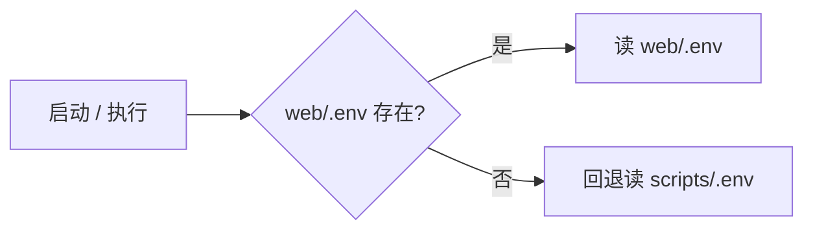

# 03 配置初始化

**目标**：配好 `web/.env` 与企业微信机器人，让脚本和 Web 读到同一份配置。

---

## 1. 配置只有一份：web/.env

这是本项目的**唯一真相源**。脚本与 Web 的加载顺序完全一致：



- 由 `scripts/project_config.sh` 解析 `ENV_FILE`，Web 侧由 `web/types/env.ts` 解析，规则一致。
- **不要同时维护两份**，否则会出现「页面改了、提醒没生效」。
- `.env` 不提交 git（已被 `.gitignore` 忽略），模板从 `web/.env.example` 复制。

---

## 2. 创建配置

```bash
cp web/.env.example web/.env
vim web/.env
```

最小可用配置（先跑通再补）：

```bash
# 城市（天气用）
WEATHER_CITY_NAME=深圳

# 生日列表：姓名|生日|企业微信ID，多人用分号分隔
BIRTHDAY_LIST=张三|1990-05-20|@zhangsan
```

### 生日列表格式（完整）

| 格式 | 示例 | 说明 |
|------|------|------|
| 完整公历 | `张三\|1990-05-20\|@zhangsan` | 含出生年份，可计算年龄 |
| 简化公历 | `王五\|06-01\|@wangwu` | 不含年份 |
| 农历生日 | `李四\|lunar:08-15\|@lisi` | 自动转换为当年公历 |

### API Key 怎么获取

1. 注册 [聚合数据](https://www.juhe.cn/) 账号
2. 申请**天气预报、黄历、星座运势**三个 API
3. 填入对应 Key（免费版有调用次数限制，凌晨预获取机制正是为了省调用次数）

### 星座硬编码

`scripts/weather_config.sh` 中 `ZODIAC_SIGN="天秤座"`，直接改文件（不走 `.env`）。

### holiday_config.sh（年度更新自动生成，一般别手改）

```bash
declare -A HOLIDAYS_2026=(
    ["2026-01-01"]="元旦|2"
    ["2026-01-28"]="公司特别假|2"    # 春节前调休日→公司特别假
    ["2026-02-07"]="调休上班|3"
)
# 类型：2=节假日（放假），3=调休上班日
```

查询函数：`is_holiday` / `is_adjust_workday` / `is_workday`（推荐第三个）。年度更新会自动生成并处理「公司特别假」。

---

## 3. 配置项速查

| 分类 | 变量 | 必填 | 作用 |
|------|------|------|------|
| 天气/黄历/星座 | `JUHE_WEATHER_KEY` `JUHE_ALMANAC_KEY` `JUHE_HOROSCOPE_KEY` | 选填 | 对应功能未配置则不可用 |
| 城市 | `WEATHER_CITY_NAME` | 选填 | 默认深圳 |
| 生日 | `BIRTHDAY_LIST` `BIRTHDAY_ADVANCE_DAYS` `BIRTHDAY_SEND_ON_BIRTHDAY` `BIRTHDAY_REMINDER_TIME` | 选填 | 农历用 `lunar:MM-DD` |
| 登录（Web） | `MAIL_HOST` `MAIL_PORT` `MAIL_USERNAME` `MAIL_PASSWORD` `MAIL_ENCRYPTION` `MAIL_FROM_ADDRESS` `MAIL_FROM_NAME` | **登录必填** | 邮箱验证码；`MAIL_USERNAME` 同时是管理员邮箱 |
| 鉴权 | `JWT_SECRET` | 建议填 | 不填则每次启动随机生成，重启后全员掉线 |
| AI | 模型配置在 Web「系统配置 → AI 模型与记忆」维护，存 `.cache/ai-model-configs.json` | 选填 | 原 `.env` 配置已迁移为 JSON 配置组；保存后立即生效，无需重启 |
| 服务 | `WEB_PORT`（默认 9527）`VITE_PORT`（默认 5173）`NODE_ENV` | 选填 | Web 端口 / 开发模式 |

> 完整字段说明以 `web/.env.example` 内的注释为准。

---

## 4. 企业微信机器人（不在 .env 里）

Webhook 已迁移到 Web 界面管理，存在 `.cache/webhooks.json`：

1. 打开 `http://<机器IP>:9527`
2. 「系统配置」→「企业微信机器人」→ 添加
3. 多个机器人会轮流发送（负载均衡）

---

## 5. 改完配置要不要重启

| 改动内容 | 提醒脚本 | Web 服务 |
|---------|---------|---------|
| API Key、城市、生日列表 | 下次执行自动生效（每次重新 source） | 部分需重启 |
| `MAIL_*`、`JWT_SECRET` | 不涉及 | **必须重启** |
| 模型配置（JSON 配置组） | 下次执行自动生效 | 立即生效 |
| 企业微信机器人 | 立即生效 | 立即生效 |

重启 Web：`bash scripts/start_web.sh restart`

---

## 6. 验证配置生效

```bash
# 脚本侧：应打印 web/.env 路径，并能读到变量
bash -c 'source scripts/weather_config.sh 2>/dev/null; echo "ENV_FILE=$ENV_FILE"; echo "CITY=${WEATHER_CITY_NAME:-未配置}"; echo "MAIL=${MAIL_HOST:-未配置}"'

# Web 侧：读到的键数量与关键项
cd web && npx ts-node -r tsconfig-paths/register -e "
const env = require('./utils/env').readEnvFile();
console.log('keys:', Object.keys(env).length, '| city:', env.WEATHER_CITY_NAME || '-');
"
```

---

## 7. 检查清单

- [ ] `web/.env` 已创建且内容填写完毕
- [ ] 脚本侧 `ENV_FILE` 指向 `web/.env`
- [ ] Web 能启动，登录邮箱能收到验证码（SMTP 配好）
- [ ] 已在 Web 添加至少一个机器人

---

**返回**: [教程索引](00-导航.md) | [上一篇：系统概述与项目结构](02-系统概述与项目结构.md) | [下一篇：跑通第一个提醒](04-跑通第一个提醒.md)
