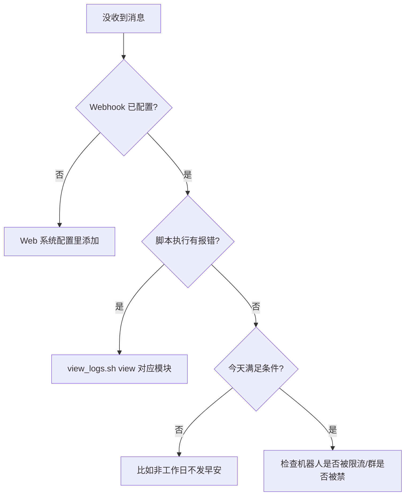

# 04 跑通第一个提醒

**目标**：手动发出第一条企业微信消息，把「配置 → 脚本 → 推送」整条链路走通。

---

## 1. 先做一次不发消息的验证

数据预获取只拉数据、不推送，最安全的第一步：

```bash
bash scripts/daily_data_manager.sh prefetch
bash scripts/daily_data_manager.sh read weather
```

预期：脚本打印天气数据（没配 `JUHE_WEATHER_KEY` 会提示未配置，属正常）。

```bash
# 星座判断也是纯输出
bash scripts/get_zodiac_sign.sh
# 农历转换
python3 scripts/date_utils.py birthday 10 16
```

---

## 2. 确认机器人已配置

消息要发得出去，先确认 Web「系统配置 → 企业微信机器人」里已配好机器人（数据存数据库 `hp_webhooks` / `webhooks.json` 缓存键，不再有 `.cache/` 文件）：

为空就添加一个（见 [03](03-配置初始化.md)）。

---

## 3. ⚠️ 发出第一条消息

以下命令**会真的推送到群里**，确认群没选错再执行：

```bash
bash scripts/workday_manager.sh morning
```

随后立刻看日志确认结果：

```bash
bash scripts/view_logs.sh view workday
```

日志里应能看到消息发送过程；群里应收到早安提醒（含天气/黄历等占位数据）。

其他可选的首发脚本：

| 命令 | 说明 |
|------|------|
| ⚠️ `bash scripts/festival_greetings.sh holiday` | 节日祝福（非节日可能提示无匹配） |
| ⚠️ `bash scripts/birthday_reminder.sh` | 生日提醒（先确保 `BIRTHDAY_LIST` 有今天过生日的人） |
| `bash scripts/daily_data_manager.sh prefetch` | 只拉数据，不推送 |

---

## 4. 三种触发方式对比

| 方式 | 命令/入口 | 适用场景 |
|------|----------|---------|
| 命令行手动 | `bash scripts/workday_manager.sh morning` | 调试、补发 |
| 让贾维斯执行 | 聊天里说「发一次早安提醒」，它调 `trigger_script` | 不想敲命令 |
| 守护进程定时 | `bash scripts/daemon.sh start` | 正式运行 |

> 原 Web「手动触发」页已下线，跑脚本走命令行或贾维斯。

---

## 5. 小实验：改配置立刻看到效果

```bash
# 1. 在 web/.env 里把城市改成北京
sed -i 's/^WEATHER_CITY_NAME=.*/WEATHER_CITY_NAME=北京/' web/.env

# 2. 重新拉数据（不需要重启任何东西）
bash scripts/daily_data_manager.sh prefetch

# 3. 看结果
bash scripts/daily_data_manager.sh read weather
```

体会一下：提醒脚本**每次执行都重新加载配置**，所以改完即生效。

---

## 6. 没收到消息？按这个顺序查



常用排查命令：

```bash
bash scripts/view_logs.sh error          # 所有错误日志
bash scripts/view_logs.sh view workday   # 指定模块
# 机器人配置见 Web「系统配置 → 企业微信机器人」（数据存数据库，不再有 .cache/webhooks.json 文件）
```

---

## 7. 检查清单

- [ ] `daily_data_manager.sh prefetch` 能跑通
- [ ] 已配置至少一个机器人
- [ ] 手动执行 `workday_manager.sh morning` 群里收到消息
- [ ] 会用 `view_logs.sh` 看结果

---

**返回**: [教程索引](00-导航.md) | [上一篇：配置初始化](03-配置初始化.md) | [下一篇：提醒脚本体系](05-提醒脚本体系.md)
