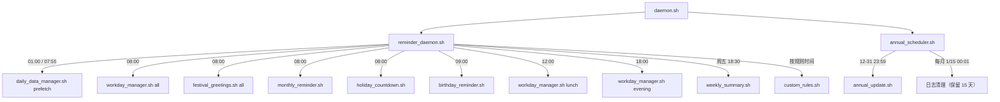

# 05 提醒脚本体系

**目标**：明白「谁在什么时候被调起」，以及如何安全地调整。

---

## 1. 两层调度

```
daemon.sh  →  reminder_daemon.sh（按分钟轮询时间，触发各提醒）
            →  annual_scheduler.sh（年度更新 + 日志清理）
```



完整时间表：

| 时间 | 脚本 | 功能 | 条件 |
|------|------|------|------|
| 01:00 | `daily_data_manager.sh prefetch` | 数据预获取 | 每天 |
| 07:55 | `daily_data_manager.sh prefetch` | 备用预获取 | 01:00 失败时 |
| 08:00 | `workday_manager.sh all` | 调休+早安提醒 | 工作日 |
| 08:00 | `festival_greetings.sh all` | 节日祝福 | 节假日/节气日 |
| 08:00 | `monthly_reminder.sh` | 月度提醒 | 每月 1 日或最后一天 |
| 08:00 | `holiday_countdown.sh` | 假期倒计时 | 距假期 ≤3 天 |
| 09:00 | `birthday_reminder.sh` | 生日检查 | 每天 |
| 12:00 | `workday_manager.sh lunch` | 午餐提醒 | 工作日 |
| 18:00 | `workday_manager.sh evening` | 下班提醒 | 工作日 |
| 18:30 | `weekly_summary.sh` | 周总结 | 周五 |

**早晨 8:00 的执行顺序**（优先级从高到低）：

```
1. workday_manager.sh all     → 调休上班 + 早安提醒
2. festival_greetings.sh all  → 节假日 → 农历 → 节气 → 特殊节日
3. monthly_reminder.sh        → 月度提醒
4. holiday_countdown.sh       → 假期倒计时
```

**典型场景**：调休日会先发「今天调休上班」；节假日不发早安但发祝福；假期前 3 天开始倒计时；月初/月底发月度提醒。

**年度任务**（由 `annual_scheduler.sh` 执行）：

| 时间 | 任务 |
|------|------|
| 12月31日 23:59 | `annual_update.sh` 年度数据更新（节假日、节气等） |
| 每月 1/15 号 00:01 | 日志清理（保留 15 天） |

---

## 2. 脚本的三种形态

| 形态 | 例子 | 特点 |
|------|------|------|
| 单文件脚本 | `birthday_reminder.sh`、`get_zodiac_sign.sh` | 逻辑简单，一个文件搞定 |
| 主脚本 + 同名子目录 | `workday_manager.sh` + `workday_manager/` | 超过 300 行或 ≥3 组功能就拆分 |
| 纯工具（被调用） | `project_config.sh`、`log_utils.sh` | 只提供函数/变量，不直接执行 |

子目录里的模块**不设**自己的 `SCRIPT_DIR` / `LOG_FILE`，由主脚本统一提供。

---

## 3. 脚本分类速查

| 类别 | 代表脚本 |
|------|---------|
| 守护进程 | `daemon.sh`、`reminder_daemon.sh`、`annual_scheduler.sh` |
| 工作日 | `workday_manager.sh`（`all`/`adjust`/`morning`/`lunch`/`evening`） |
| 节日 | `festival_greetings.sh`（`all`/`holiday`/`lunar`/`solar_term`/`special`） |
| 生日 | `birthday_reminder.sh` |
| 周期 | `weekly_summary.sh`、`monthly_reminder.sh`、`holiday_countdown.sh` |
| 数据 | `daily_data_manager.sh`（`prefetch`/`read`/`assemble`）、`fetch_real_*.sh`、`history_today.sh` |
| 自定义规则 | `custom_rules.sh` |
| 日志 | `view_logs.sh`（`list`/`view`/`tail`/`today`/`error`/`clean`） |
| 卡片 | `tools/card.sh` 及 `tools/*.sh` |

完整分类与子命令见 [`scripts/README.md`](../scripts/README.md)。

---

## 4. 自定义规则（不写代码加提醒）

不想写脚本，只想「每天 10:00 提醒喝水」——用自定义规则：

1. Web「自定义规则」→ 新建
2. 填名称、触发时间、星期、消息内容（支持模板变量）
3. 保存后由 `custom_rules.sh` 在守护进程中触发

规则数据存在 `.cache/custom_rules.json`，见 [07](07-数据与规则.md)。

---

## 5. 想改时间表怎么办

时间判定写在 `scripts/reminder_daemon.sh` 的调度循环里。改动原则：

1. 先读懂现有循环（按「时:分」匹配 + 去重标记，避免同一分钟重复发）
2. 新增一个时间点：复制相邻分支，改时间 + 脚本 + 日志
3. 改完先语法检查 `bash -n scripts/reminder_daemon.sh`
4. 重启生效：`bash scripts/daemon.sh restart`
5. 验证：把时间临时改成下一分钟，观察是否触发

> 不要在 crontab 里另起一套定时去调提醒脚本，会和守护进程重复发送。

---

## 6. 年度更新

节假日/节气/农历数据需要每年更新：

```bash
bash scripts/annual_update.sh        # 手动跑 6 步流程
```

流程由 `update-tools/` 下四个子工具串起来：获取国务院节假日 → 生成配置（含公司特别假）→ 更新月度配置 → 发通知。平时由 `annual_scheduler.sh` 在 12-31 23:59 自动触发。

---

## 7. 检查清单

- [ ] 知道提醒由 `reminder_daemon.sh` 触发，而不是 crontab 直接调脚本
- [ ] 能说出至少 5 个提醒的触发时间
- [ ] 知道改时间表后要 `daemon.sh restart`
- [ ] 知道加简单提醒优先用「自定义规则」

---

**返回**: [教程索引](00-导航.md) | [上一篇：跑通第一个提醒](04-跑通第一个提醒.md) | [下一篇：Web 管理界面](06-Web管理界面.md)
