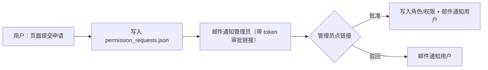

# 08 权限与用户

**目标**：把同事加进来，并且只给他该看的页面。

---

## 1. 用户从哪来

没有独立的用户注册——**用邮箱验证码登录，登录后自动成为用户**：

1. 用户输入邮箱 → 系统发验证码（SMTP）
2. 验证通过 → 签发 JWT，写入 `.cache/users.json`
3. 权限来自该邮箱在 `rbac.json` 里绑定的角色

**超级管理员**：邮箱等于 `web/.env` 中 `MAIL_USERNAME` 的那个账号，天然拥有全部权限，不受角色配置影响。

---

## 2. 权限码长什么样

格式 `模块:动作`，动作主要是 `view` / `edit`：

```
dashboard:view        查看仪表盘
daemon:view / :edit   守护进程状态 / 启停
config:view / :edit   系统配置查看 / 修改
trigger:workday:edit  执行工作日提醒脚本
ai-approvals:view     查看 AI 审批单（/approvals）
ai-approvals:edit     建审批单；通过 / 驳回另需超级管理员身份
```

**审批权是特例**：`ai-approvals:edit` 只让你建单和看单，**通过 / 驳回必须是超级管理员**（邮箱等于 `MAIL_USERNAME`）——普通管理员不能自己批自己发起的变更。

- 全量权限定义在 `.cache/permission_metas.json`（含分组、中文名、关联路由）
- 代码里的枚举在 `web/types/permission.ts`
- 路由上用 `withPermission(router, { read, write })` 挂载，后端统一校验

---

## 3. 角色

角色存在 `.cache/rbac.json`，内置 `super_admin`（超级管理员）等。管理入口：

| 页面 | 路径 | 用途 |
|------|------|------|
| 角色管理 | `/rbac/roles` | 建角色、勾权限 |
| 用户管理 | `/rbac/users` | 给邮箱绑角色 |
| 权限列表 | `/rbac/permissions` | 查看权限元数据 |
| 权限申请 | `/rbac/requests` | 审批申请单 |

典型做法：

1. 「角色管理」新建角色（如 `operator`），勾选需要的权限码
2. 「用户管理」把同事邮箱绑到该角色
3. 同事登录后菜单按权限显示，无权限访问会跳 `/unauthorized`

---

## 4. 权限申请流程

不想手工配角色时，让用户自己申请：



审批链接带一次性 token（`APPROVE_TOKEN` 相关配置），不登录也能完成审批。

---

## 5. 加新页面时要登记权限

新增页面/接口必须同步这 4 个 JSON，否则页面上看不到、用不了：

1. `.cache/permission_metas.json`：新增权限码
2. `.cache/rbac.json`：给 `super_admin` 等角色补权限
3. `.cache/api_categories.json`：分类（如需要）
4. `.cache/api_items.json`：每条新 API 登记

详见 [扩展开发](12-扩展开发.md)。

---

## 6. 检查清单

- [ ] 知道管理员 = `MAIL_USERNAME` 邮箱
- [ ] 能给同事建角色、绑邮箱
- [ ] 知道权限码是 `模块:view|edit`
- [ ] 知道加页面要同步 4 个 JSON

---

**返回**: [教程索引](00-导航.md) | [上一篇：数据与规则](07-数据与规则.md) | [下一篇：AI Agent 开发（一）心智模型](09-1-Agent心智模型.md)
