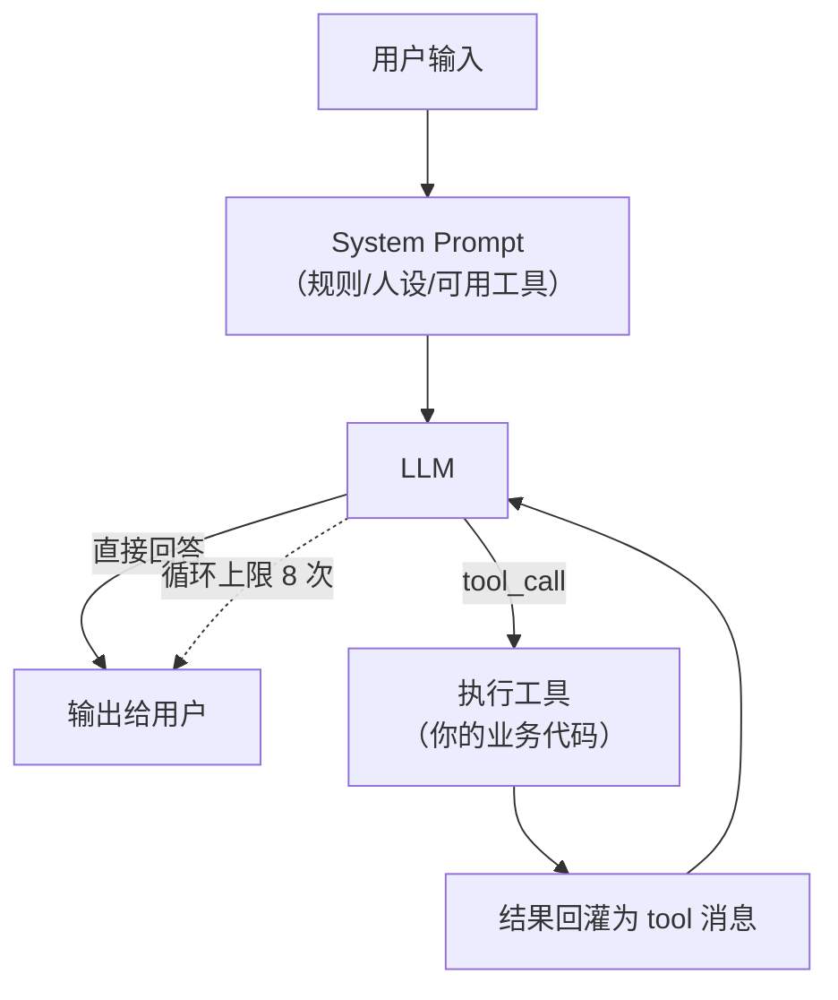

# Agent 心智模型与最小实现

> 面向**有后端/前端基础、没做过 AI Agent** 的开发者。
> 读完这篇你会知道：Agent 到底由哪几块组成，以及用最少的代码把它跑起来。
> 后续 09-2 ~ 09-5 依次加：流式输出 → 工具 → 循环与规划 → 会话与护栏。

---

## 1. 先建立心智模型：和你熟悉的东西一一对应

| 你熟悉的概念 | Agent 里的对应物 | 说明 |
|-------------|----------------|------|
| RPC / 函数接口 | **工具（Tool）** | 声明给模型看的"可调用函数"，模型返回调用意图，你来执行 |
| 业务编排器 / 状态机 | **Agent Loop** | 「问模型 → 模型要调工具 → 执行 → 把结果喂回去 → 再问」的循环 |
| 需求文档 / 业务规则 | **System Prompt** | 用自然语言写的规则，决定模型扮演谁、能做什么、怎么回答 |
| HTTP 流式响应 | **SSE 流** | 逐字吐字 + 工具调用过程实时回传 |
| 接口超时/重试/熔断 | **LLM 客户端** | 429 限流退避、网络重试、abort 中断 |
| 权限中间件 | **工具权限 + consent** | 谁能用什么工具；副作用操作必须用户明确说过 |
| 调用次数/成本 | **Token** | 每次调用都要计预算，循环不设上限会烧钱 |

**一句话定义**：Agent = 大模型 + 工具集 + 循环编排 + 护栏。

传统开发里「流程是写死的」，Agent 里「流程由模型在运行时决定」——这是最大的思维转变，也是所有复杂度（循环上限、护栏、反思）的来源。

---

## 2. 五个组成部分（记住这张图就够了）



1. **模型**：只负责"决定下一步"，不负责执行
2. **提示词**：约束它的行为边界
3. **工具**：它唯一能影响现实世界的手段
4. **循环**：让它能连续做多步（查 → 算 → 再查）
5. **护栏**：权限、耗时、次数、敏感信息

---

## 3. 最小实现：30 行跑通一次问答

先不要任何框架。OpenAI 兼容协议（智谱、DeepSeek、通义等大多兼容）最小调用如下：

```ts
// 最小可运行：一次问答（Node 18+ 自带 fetch）
const resp = await fetch(`${process.env.LLM_BASE_URL}/chat/completions`, {
  method: 'POST',
  headers: {
    'Content-Type': 'application/json',
    Authorization: `Bearer ${process.env.LLM_API_KEY}`,
  },
  body: JSON.stringify({
    model: 'glm-4.7-flash',
    messages: [
      { role: 'system', content: '你是运维助手，回答简洁，不确定就说不知道。' },
      { role: 'user', content: '服务器现在怎么样？' },
    ],
    temperature: 0.7,
  }),
});
const json = await resp.json();
console.log(json.choices[0].message.content);
```

到这里你已经有一个"聊天机器人"了。**它还不是 Agent**——因为它没有任何工具，也无法连续行动。

> 本项目对应实现：`web/utils/ai-chat/llm-client/request.ts` 的 `requestChatCompletion`（把上面这段加上了重试、模型路由、abort）。

---

## 4. 加上 System Prompt：把规则写清楚

System Prompt 就是**用自然语言写的需求文档**，三段式最稳：

```
1. 身份与边界：你是谁、服务谁、不能做什么
2. 可用能力：有哪些工具，各自什么时候用（不要全列，按场景分组）
3. 输出规范：格式、语气、不确定时怎么办、"禁止编造"
```

经验：

- **不要写"你要努力帮我"这类空话**，写具体约束（"查不到就回答查不到，不要猜测数值"）
- 工具的**使用场景**写在 description 里比写在 prompt 里更有效（见第 03 篇）
- Prompt 会随工具数量膨胀，本项目做法：`system-prompt.ts` 里写固定规则 + 动态拼接工具速查表

---

## 5. 本项目的分层（对应你将要搭的东西）

| 层 | 职责 | 本项目位置 |
|----|------|-----------|
| L1 入口层 | 对话 UI、开关（工具/联网/规划/模型） | `web/frontend` 的 AI 抽屉 |
| L2 传输层 | SSE 事件协议 | `routes/ai-chat.ts` + `types/ai-chat.ts` |
| L3 接口层 | 鉴权、限流、会话装载 | `routes/ai-chat.ts:334-454` |
| L4 编排层 | Agent Loop / 规划 / 反思 | `agent-loop.ts`、`planning.ts` |
| L5 能力层 | 25 个工具 | `tools/*-tool.ts` |
| L6 基建层 | LLM 客户端、会话存储、进程 | `llm-client/`、`conversation-store.ts` |

自己搭的时候**不需要分六层**，但要知道每层的职责——尤其「编排层」和「工具层」要分开，否则工具一多就变成面条代码。

---

## 6. 新手最容易踩的三个坑

| 坑 | 表现 | 解法 |
|----|------|------|
| 把 Agent 当聊天机器人 | 用户问什么都直接答，从不调工具 | 在 prompt 里明确「能查的必须查，不要凭记忆回答」 |
| 循环不设上限 | 一次提问烧掉几十次调用 | 硬上限（本项目 8 次）+ 工具超时（30s）+ token 预算 |
| 业务规则写死在代码里 | 改一句文案要重新发版 | 规则写进 prompt / 配置文件，代码只做编排与执行 |

---

## 7. 动手练习

1. 用上面的 30 行代码，改成你自己的模型地址，跑通一次问答
2. 把 system prompt 改成"只能回答与天气有关的问题"，验证它会不会拒绝其它问题
3. 观察一次调用的返回结构：`choices[0].message` 里除了 `content` 还有什么字段（下一篇要用）

---

## 8. 检查清单

- [ ] 能说出 Agent 的五个组成部分
- [ ] 跑通了一次最小问答
- [ ] 知道 system prompt 应该写什么、不该写什么
- [ ] 知道循环必须设上限的原因

---

**返回**: [教程索引](00-导航.md) | [上一篇：权限与用户](08-权限与用户.md) | [下一篇：LLM 客户端与流式输出](09-2-LLM客户端与流式.md)
