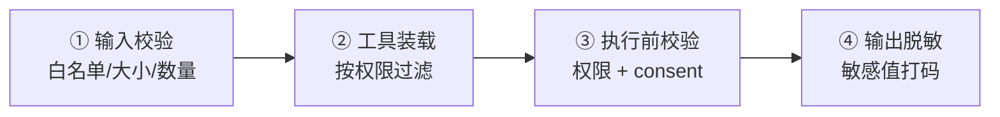

# 会话、护栏与工程化

**目标**：把能跑的 Agent 变成能上线的 Agent——会话持久化、安全护栏、可观测性、调优与排障。

---

## 1. 会话存储：为什么不能只放内存

Agent 的上下文就是钱。每次请求都要带上历史消息，所以必须持久化，并且要控制长度。

本项目做法（文件存储，无数据库也够用）：

```
.cache/ai-conversations/<邮箱>/conv_<时间戳>_<随机>.json
```

```ts
// web/utils/ai-chat/conversation-store.ts（精简）
const userDir = (userEmail: string): string => {
  const safe = userEmail.replace(/[^a-zA-Z0-9_.@-]/g, '_');   // 邮箱做目录名要过滤非法字符
  return path.join(AI_CONVERSATIONS_DIR, safe);
};
```

要点：

| 设计 | 说明 |
|------|------|
| 按用户隔离 | 目录即边界，天然看不到别人的会话 |
| 文件名净化 | 邮箱里的 `@`/`.` 之外的非法字符替换，避免路径穿越 |
| 滑动窗口 | `MAX_MESSAGES_PER_CONVERSATION = 50`，超出丢最早的 |
| 落盘时机 | 收到 `done` 才写——**这也是「重启 Web 要延迟 8 秒」的原因**（见第 4 节） |
| 标题自动生成 | 首条用户消息取前 20 字 |

**取舍**：滑动窗口会丢早期上下文。更省 token 的做法是对历史做摘要（把前 N 条压成一条 summary），代价是多一次 LLM 调用。项目里先用窗口，够用且不引入复杂度。

---

## 2. 护栏：四道防线



1. **输入**：脚本名 `/^[a-z0-9_]+\.sh$/`；图片仅 `data:image/*;base64`、≤4 张、≤8M 字符；请求体上限 `32mb`
2. **装载**：没权限的工具不进可选列表（03 篇）
3. **执行前**：权限码校验 + consent 短语校验（03 篇）
4. **输出**：`query_config` 读到的密钥、Webhook URL 一律脱敏为 `***（已脱敏）`

**最重要的一条**：本项目**不存在任何能修改 `.env` 的工具**。能读不能写——这是最后一道保险，避免模型（或被诱导的 prompt）改动系统配置。

---

## 3. 可观测性：三样东西必须有

| 手段 | 用途 |
|------|------|
| 事件流（`iteration_usage` / `tool_result` / `reflection`） | 定位"它为什么这么答" |
| Token 用量累加 | 成本控制，发现异常循环 |
| 服务端日志 | 上游错误、工具加载失败、重试次数 |

排查顺序：**先看事件流**（哪一轮、调了什么工具、返回什么）→ **再看用量**（是不是循环失控）→ **最后看服务日志**（是不是上游/权限问题）。

---

## 4. 工程化：三个真实场景的解法

### 4.1 重启自己时，先让会话落盘

Agent 让你"重启 Web 服务"时，如果 9527 进程直接自杀，当前 SSE 流会断，**这一轮问答（含你刚发的消息）来不及落盘就丢了**。

解法：借道 3001 启动器，延迟 8 秒执行：

```ts
POST http://127.0.0.1:3001/api/launcher/restart  { delay_ms: 8000 }
```

先说完结论 → 落盘 → 回 `done` → 再重启。launcher 不可用时回退同步重启，并明确提示"本轮会话可能中断"。

### 4.2 请求体与图片

对话要带图片 base64，体积大，所以要显式放开 body 限制：`AI_CHAT_SEND_BODY_LIMIT = '32mb'`。前端侧先压缩（最长边 1280px、JPEG 0.85）再传——**压缩放在前端是刚需**，否则 32mb 也不够。

### 4.3 模型能力分流

同一个 Agent 可能面对：文本模型、视觉模型、文生图、文生视频。做法是**按模型能力分流**：

- 视觉模型才能带图片（非视觉模型上传图片会被忽略或报错）
- 图片/视频走"提交任务 + 轮询"，并把轮询进度也用事件回传（02 篇）

---

## 5. 调优清单

| 项 | 建议 |
|----|------|
| 模型 | 日常用 flash 级（快且便宜），复杂推理再换大模型 |
| `max_tokens` | 4096 起步；输出被截断就调大，成本敏感就调小 |
| `temperature` | Agent 场景偏低（0.3–0.7），要稳定不要发散 |
| 工具数量 | 控制在 30 个以内，超出按场景动态装载 |
| 规划模式 | 默认关；多步复杂任务再开 |
| 反思 | 只在用过工具时触发，上限 2 轮 |
| 循环上限 | 8 次足够；先观察真实任务分布再调 |
| 上下文 | 50 条窗口；长会话考虑摘要压缩 |

---

## 6. 排障对照表

| 现象 | 排查 |
|------|------|
| 提示未配置 Key | `web/.env` 的 `LLM_API_KEY`，改完**重启 Web** |
| 一直转圈无输出 | `view_logs.sh view web_server` 查库；看有没有 `notice` 重试事件；确认能访问 `LLM_BASE_URL` |
| 工具调用失败 | 脚本缺失？权限不足？看 `tool_result` 事件的 `error` |
| 说"无权限 xxx" | 给角色补权限码，见 [08 权限与用户](08-权限与用户.md) |
| 图片没被理解 | 当前不是视觉模型，换带 vision 的模型 |
| 会话丢了 | 只有收到 `done` 才落盘；异常中断会丢最后一轮 |
| 成本异常 | 看 `iteration_usage` 是不是循环失控（反思/规划反复触发） |

---

## 7. 在本项目里继续扩展

| 想加什么 | 怎么做 |
|---------|--------|
| 新工具 | 新建 `web/utils/ai-chat/tools/xxx-tool.ts` 导出 `ToolImpl`，自动注册（无需改注册文件） |
| 新卡片技能 | 在 `scripts/tools/` 加脚本（stdout 只输出 PNG 路径），`card_skill` 工具自动可用 |
| 新可触发脚本 | 在 `scripts/` 加 `.sh`，即可被 `trigger_script` 调用（或让贾维斯直接执行） |
| 架构图/时序图技能 | 走 `scripts/tools/diagram_card.sh`，用 JSON spec 描述图 |

使用侧的操作（配模型、会话管理、开关）见 [贾维斯使用说明](14-贾维斯使用说明.md)；本项目的 36 个工具清单见 [09-3 Agent 工具系统](09-3-Agent工具系统.md) 第 8 节。

---

## 8. 动手练习

1. 给自己加一个只读工具，并给自己角色补上对应权限码，验证"没权限时工具消失"
2. 上传一张图片 + 非视觉模型，观察报错；切到视觉模型再试一次
3. 触发一次"重启 Web 服务"，观察是否先返回完成再重启（会话有没有丢）

---

## 9. 检查清单

- [ ] 会话持久化、按用户隔离、有长度上限
- [ ] 四道护栏：输入校验 / 权限装载 / 执行前校验 / 输出脱敏
- [ ] 没有任何工具能修改系统配置
- [ ] token 用量可观测，成本异常能发现
- [ ] 重启类操作不会丢会话
- [ ] 有清晰的排障路径

---

**返回**: [教程索引](00-导航.md) | [上一篇：循环、规划与反思](09-4-Agent循环与反思.md) | [下一篇：提示词工程](09-6-提示词工程.md)
