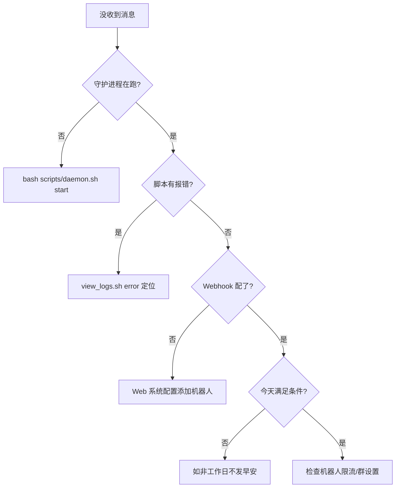

# 11 日志与排障

**目标**：出问题时不靠猜，靠日志定位。

---

## 1. 日志在哪

**全系统日志只有一份真源：MySQL 表 `hp_run_logs`**（建表脚本 `sql/logs/33_run_logs.sql`，由 `helper_database.sql` 初始化）。

系统不再写任何日志文件：`scripts/*.log`、`scripts/web_access.log`、`web/.runtime/web_server.jsonl`、`.cache/ai-traces/*.jsonl` 都是改造前的历史残留，不会再被追加。磁盘上如果还留着这些文件，可以自行删除，程序不依赖它们。

| 来源类型 `source_type` | 主要 `source` | 产生方式 |
|------|------|------|
| `script` | `reminder_daemon`、`birthday_reminder`、`tools`、`daily_data_manager`… | shell 脚本统一走 `scripts/log_utils.sh` → `scripts/log_db.sh` |
| `web` | `web_server` | Web 服务 / 启动器劫持 `console.*` → `web/utils/access-log` |
| `access` | `web_access` | HTTP 请求经 `accessLogMiddleware` 记录 |
| `ai` | `ai_trace`（结构化追踪） | AI 运行追踪写 `hp_ai_run_traces` |

关键字段：`logged_at`（发生时间）、`level`、`source`、`message`、`context`（结构化上下文 JSON）、`caller`、`hostname`、`pid`。按 `source` / `level` / 时间检索，索引见建表脚本。

> 连接参数复用 `web/.env` 的 `DB_HOST / DB_PORT / DB_USER / DB_PASSWORD / DB_NAME`；shell 侧需要本机可用 `mysql` 客户端。
> 日志写入失败时**静默降级为仅 stderr 输出**，绝不阻塞业务；同一进程只告警一次。

AI 成本看板的数据源是 `hp_ai_run_traces`（`sql/ai/27_ai_run_traces.sql`），同样不再落 `.cache` 文件。

---

## 2. 查看命令

```bash
bash scripts/view_logs.sh list                  # 列出所有日志来源及记录数
bash scripts/view_logs.sh view reminder_daemon  # 最近 50 条
bash scripts/view_logs.sh tail prefetch         # 实时跟踪（每 2 秒轮询库）
bash scripts/view_logs.sh today workday         # 只看今天
bash scripts/view_logs.sh error                 # 最近 50 条错误
bash scripts/view_logs.sh success               # 最近 50 条成功
bash scripts/view_logs.sh states                # 各来源统计
bash scripts/view_logs.sh report                # 分析报告
bash scripts/view_logs.sh clean                 # 交互式清空全部记录
```

也可以直接查库或走 Web「运行日志」页 / 贾维斯 `query_logs`：

```bash
mysql -h 127.0.0.1 -u helper -p helper -e \
  "SELECT logged_at, level, source, message FROM hp_run_logs WHERE level='ERROR' ORDER BY id DESC LIMIT 20;"
```

常用来源名：`reminder_daemon`、`daily_data_manager`、`festival_greetings`、`birthday_reminder`、`fetch_real_weather`、`fetch_real_almanac`、`fetch_real_horoscope`、`history_today`、`workday_manager`、`monthly_reminder`、`annual_scheduler`、`web_server`、`web_access`、`tools`。命令也接受库里出现的任意来源名。

日志清理：Web 启动时及每 24 小时按 `LOG_RETENTION_DAYS`（默认 15 天）删除过期记录；`annual_scheduler.sh` 另在每月 1/15 号 00:01 执行一次兜底清理。清空操作删除的是库记录，不可恢复。

---

## 3. 脚本里怎么写日志

统一用 `log_utils.sh`，不要 `echo`：

```bash
source "${PROJECT_DIR}/log_utils.sh"
log_info "开始执行"
log_success "推送完成"
log_warning "未配置 Key，跳过"
log_error "发送失败: ${reason}"
```

每条日志同时做两件事：**输出到 stderr**（给前台/交互式运行看）和**写入 `hp_run_logs`**（唯一持久化落点）。支持级别 DEBUG/INFO/WARNING/ERROR；`LOG_FORMAT` 只影响终端输出格式，入库字段不受影响。

### log_utils API

| 函数 | 说明 |
|------|------|
| `log_info "msg" ['{"k":"v"}']` | 一般信息，无图标；第二个参数为可选 JSON 上下文 |
| `log_success "msg"` | 自动加 ✅ |
| `log_warning "msg"` | 自动加 ⚠️ |
| `log_error "msg"` | 自动加 ❌ |
| `log_debug "msg"` | 仅 `LOG_LEVEL=DEBUG` 时输出 |
| `log_duration $start_ms "任务名"` | 记录耗时，超 5 秒自动标 WARNING |
| `log_separator ["标题"]` | 分隔线 |

配置变量（source 之前设置）：`LOG_FILE`（**仅作来源标识**，不再是落盘路径；不设时按调用脚本名推导）、`LOG_FORMAT`（text/json）、`LOG_LEVEL`（默认 INFO）、`LOG_RETENTION_DAYS`（日志保留天数）。

> 兼容说明：现有约 40 个脚本仍保留 `LOG_FILE="${PROJECT_DIR}/xxx.log"` 赋值，它现在只用于推导 `source`，不会创建文件。

最佳实践：

- `log_success/warning/error` 自动加图标，消息里**不要再手写图标**（会双图标）
- 消息要带上下文：`log_error "API调用失败: status=500, url=/api/data"`，不要只写「失败」
- cron 不要再重定向到 `*.log`；stderr 可以直接丢弃或由 cron 自身收集：`0 8 * * * bash script.sh 2>/dev/null`

---

## 4. 排障 SOP

**消息没发**



**Web 打不开**

```bash
bash scripts/start_web.sh status
lsof -ti:9527                                  # 端口有没有进程
bash scripts/view_logs.sh view web_server      # 最近 50 条服务日志
bash scripts/view_logs.sh error                # 全局错误
bash scripts/start_web.sh restart
```

**日志没进库**

```bash
command -v mysql                               # shell 侧入库依赖 mysql 客户端
grep -E '^DB_(HOST|PORT|USER|NAME)=' web/.env # 连接参数是否齐全
bash scripts/view_logs.sh list                 # 有输出说明库可读
bash scripts/start_web.sh restart              # Web 侧改动需重启进程才生效
```

**数据没拉到**

```bash
bash scripts/daily_data_manager.sh prefetch      # 手动重试
bash scripts/view_logs.sh view daily_data_manager
ping www.baidu.com                                # 网络
grep JUHE web/.env                                # Key 是否配置
```

**农历生日不对**

```bash
python3 scripts/date_utils.py birthday 10 16     # 验证转换
pip3 list | grep lunar                            # 依赖在不在
```

**同一条提醒发了多次**

```bash
ps -eo pid,args | grep reminder_daemon.sh | grep -v grep   # 是否有多个实例
bash scripts/daemon.sh restart                              # 多实例时重启归一
```

---

## 5. 常见问题 FAQ

**Q1 如何添加生日？** 编辑 `web/.env` 的 `BIRTHDAY_LIST`（格式见 [配置初始化](03-配置初始化.md)），改完无需重启。

**Q2 如何修改祝福语？** 在 Web「节日祝福语」页维护（数据库 `greetings.json` 缓存键 / `hp_greetings`，按节气/节假日/农历/特殊节日/生日模板分组）。

**Q3 如何添加节假日？** 编辑 `scripts/holiday_config.sh`，`["日期"]="名称|2或3"`；通常由年度更新自动生成。

**Q4 如何修改/禁用某个提醒？** 编辑 `scripts/reminder_daemon.sh` 的时间条件或注释脚本调用行，改完 `daemon.sh restart`。

**Q5 数据预获取失败？** 查网络 `ping www.baidu.com` → 查 Key `grep JUHE web/.env` → 看日志 → 手动重试。01:00 失败后 07:55 会自动重试。

**Q6 农历生日怎么配？** `lunar:MM-DD` 格式；验证：`python3 scripts/date_utils.py birthday 08 15`。

**Q7 农历转换失败？** `pip3 install --upgrade lunar-python`。

**Q8 时区不对？** `export TZ='Asia/Hong_Kong'` 并写入 `~/.bashrc`。

**Q9 缓存读取失败？** 确认当天缓存条目（如 `daily_data_YYYY-MM-DD.json`）在数据库中存在 → `prefetch` 重新获取 → 脚本会自动降级实时 API。注意业务缓存（每日数据、API 响应归档）以数据库条目形式存放，**不是日志**，与 `hp_run_logs` 分开维护。

**Q10 定期维护做什么？**

| 频率 | 任务 |
|------|------|
| 每周 | `daemon.sh status` 确认在跑 |
| 每月 | `view_logs.sh states` 检查日志量与错误数 |
| 每季度 | `grep "$(date +%Y)" scripts/holiday_config.sh` 验证节假日 |
| 每年 | 年度数据更新（通常自动） |

---

## 6. 检查清单

- [ ] 知道所有日志统一落在 `hp_run_logs`，不再有日志文件
- [ ] 会用 `view_logs.sh` 的 list/view/error
- [ ] 会按 SOP 排查「没发消息」「Web 打不开」「日志没进库」
- [ ] 写脚本用 `log_utils`，不用 `echo`、不重定向 `*.log`

---

**返回**: [教程索引](00-导航.md) | [上一篇：信息卡片](10-信息卡片.md) | [下一篇：扩展开发](12-扩展开发.md)
