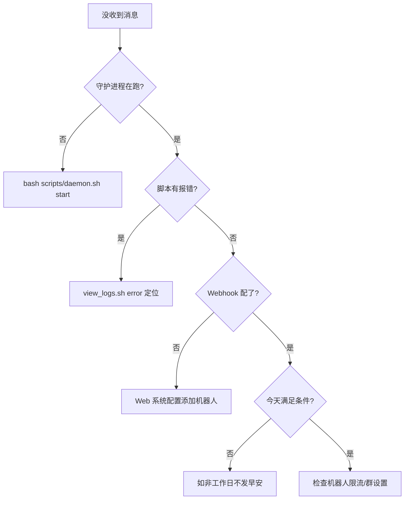

# 11 日志与排障

**目标**：出问题时不靠猜，靠日志定位。

---

## 1. 日志在哪

| 位置 | 内容 |
|------|------|
| `scripts/*.log` | 提醒脚本日志（16+ 个，按模块分） |
| `web/.runtime/web_server.jsonl` | Web 主服务日志（JSONL，每行一条） |
| `web/.runtime/web_launcher.log` | 启动器日志 |
| `scripts/reminder_daemon.log` | 守护进程（含 `daemon.sh status` 的输出） |
| `scripts/annual_scheduler.log` | 年度调度器 |

> Web 服务日志是 **JSONL**（每行一条 JSON），管理界面「运行日志」页会渲染成 `[时间] [级别] 消息` 展示。
> 它是服务运行日志的**唯一真源**：`start_web.sh` 不再把 stdout 重定向成第二份纯文本副本。

> 结构化日志表 `hp_run_logs`（见 `sql/logs/33_run_logs.sql`，由 `helper_database.sql` 初始化）用于统一收录脚本日志、Web JSONL、接口访问日志与 AI 日志，按 `source_type` / `source` 区分来源，`context` 存结构化上下文。
> 该表是日志入库后的检索层，不替代日志文件；脚本写日志仍统一走 `log_utils.sh`。

---

## 2. 查看命令

```bash
bash scripts/view_logs.sh list                  # 列出所有日志文件
bash scripts/view_logs.sh view reminder_daemon  # 最近 50 行
bash scripts/view_logs.sh tail prefetch         # 实时跟踪
bash scripts/view_logs.sh today workday         # 只看今天
bash scripts/view_logs.sh error                 # 所有错误
bash scripts/view_logs.sh clean                 # 交互式清空
```

常用日志名：`reminder_daemon`、`prefetch`、`holiday`、`birthday`、`weather`、`almanac`、`horoscope`、`history`、`workday`、`monthly`、`special`、`lunar`、`solar`、`scheduler`、`annual`。

> 注意：`view_logs.sh` 某些子命令退出码非 0（内部 grep 无匹配），不要用 `cmd && next` 串联判断。

日志自动清理：每月 1 号/15 号保留最近 15 天（由 `annual_scheduler.sh` 执行）。

---

## 3. 脚本里怎么写日志

统一用 `log_utils.sh`，不要 `echo`：

```bash
source "${PROJECT_DIR}/log_utils.sh"
log_info "开始执行"
log_success "推送完成"
log_warning "未配置 Key，跳过"
log_error "发送失败: ${reason}"
```

支持级别（DEBUG/INFO/WARNING/ERROR）与格式（text/json），输出同时进文件与 stderr。

### log_utils API

| 函数 | 说明 |
|------|------|
| `log_info "msg" ['{"k":"v"}']` | 一般信息，无图标；第二个参数为可选 JSON 上下文（仅 json 格式生效） |
| `log_success "msg"` | 自动加 ✅ |
| `log_warning "msg"` | 自动加 ⚠️ |
| `log_error "msg"` | 自动加 ❌ |
| `log_debug "msg"` | 仅 `LOG_LEVEL=DEBUG` 时输出 |
| `log_duration $start_ms "任务名"` | 记录耗时，超 5 秒自动标 WARNING |
| `log_separator ["标题"]` | 分隔线 |

配置变量（source 之前设置）：`LOG_FILE`（默认 `/dev/stdout`，设了就同时落文件）、`LOG_FORMAT`（text/json）、`LOG_LEVEL`（默认 INFO）。

最佳实践：

- `log_success/warning/error` 自动加图标，消息里**不要再手写图标**（会双图标）
- 消息要带上下文：`log_error "API调用失败: status=500, url=/api/data"`，不要只写「失败」
- cron 环境输出走 stderr，日志文件自动去色：`0 8 * * * LOG_FILE=/path/log bash script.sh 2>/dev/null`

---

## 4. 排障 SOP

**消息没发**



**Web 打不开**

```bash
bash scripts/start_web.sh status
lsof -ti:9527                       # 端口有没有进程
grep '"level":"error"' web/.runtime/web_server.jsonl | tail -20   # 只看错误
# 完整日志用管理界面「运行日志」页查看（已渲染成文本，不用读 JSON）
bash scripts/start_web.sh restart
```

**数据没拉到**

```bash
bash scripts/daily_data_manager.sh prefetch      # 手动重试
bash scripts/view_logs.sh view prefetch
ping www.baidu.com                                # 网络
grep JUHE web/.env                                # Key 是否配置
```

**农历生日不对**

```bash
python3 scripts/date_utils.py birthday 10 16     # 验证转换
pip3 list | grep lunar                            # 依赖在不在
```

**同一条提醒发了多次**

```bash
ps -eo pid,args | grep reminder_daemon.sh | grep -v grep   # 是否有多个实例
bash scripts/daemon.sh restart                              # 多实例时重启归一
```

---

## 5. 常见问题 FAQ

**Q1 如何添加生日？** 编辑 `web/.env` 的 `BIRTHDAY_LIST`（格式见 [配置初始化](03-配置初始化.md)），改完无需重启。

**Q2 如何修改祝福语？** 编辑 `.cache/greetings.json`（节气/节假日/农历/特殊节日/生日模板分组）。

**Q3 如何添加节假日？** 编辑 `scripts/holiday_config.sh`，`["日期"]="名称|2或3"`；通常由年度更新自动生成。

**Q4 如何修改/禁用某个提醒？** 编辑 `scripts/reminder_daemon.sh` 的时间条件或注释脚本调用行，改完 `daemon.sh restart`。

**Q5 数据预获取失败？** 查网络 `ping www.baidu.com` → 查 Key `grep JUHE web/.env` → 看日志 → 手动重试。01:00 失败后 07:55 会自动重试。

**Q6 农历生日怎么配？** `lunar:MM-DD` 格式；验证：`python3 scripts/date_utils.py birthday 08 15`。

**Q7 农历转换失败？** `pip3 install --upgrade lunar-python`。

**Q8 时区不对？** `export TZ='Asia/Hong_Kong'` 并写入 `~/.bashrc`。

**Q9 缓存读取失败？** 确认当天文件存在 → `prefetch` 重新获取 → 脚本会自动降级实时 API。

**Q10 定期维护做什么？**

| 频率 | 任务 |
|------|------|
| 每周 | `daemon.sh status` 确认在跑 |
| 每月 | `ls -lh scripts/*.log` 检查日志大小 |
| 每季度 | `grep "$(date +%Y)" scripts/holiday_config.sh` 验证节假日 |
| 每年 | 年度数据更新（通常自动） |

---

## 6. 检查清单

- [ ] 知道日志分「脚本日志」与「Web 日志」两处
- [ ] 会用 `view_logs.sh` 的 list/view/error
- [ ] 会按 SOP 排查「没发消息」「Web 打不开」
- [ ] 写脚本用 `log_utils`，不用 `echo`

---

**返回**: [教程索引](00-导航.md) | [上一篇：信息卡片](10-信息卡片.md) | [下一篇：扩展开发](12-扩展开发.md)
