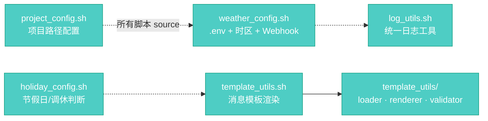
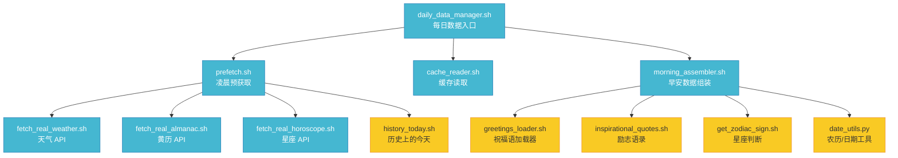
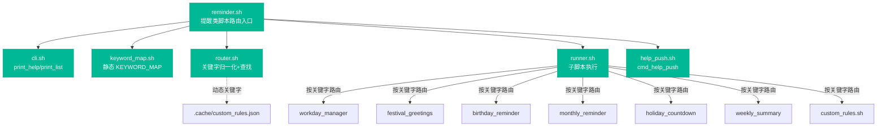
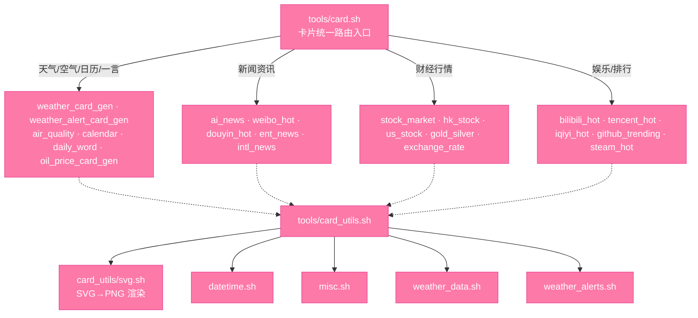
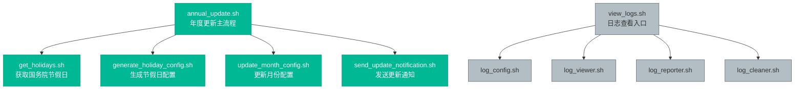

# Scripts — 提醒脚本目录

本目录包含智能提醒系统的所有脚本，负责定时发送企业微信消息、管理守护进程、预获取数据、生成信息卡片以及年度数据更新。

> 编码规范详见 [Shell 脚本编写规范](../.codebuddy/skills/helper-scripts-spec/SKILL.md)。

---

## 快速开始

```bash
# 守护进程管理（reminder_daemon + annual_scheduler 一起管理）
bash scripts/daemon.sh start          # 启动
bash scripts/daemon.sh stop           # 停止
bash scripts/daemon.sh restart        # 重启
bash scripts/daemon.sh status         # 查看状态

# Web 服务管理（server.ts:9527 + web-launcher.ts:3001）
bash scripts/start_web.sh start       # 启动
bash scripts/start_web.sh stop        # 停止
bash scripts/start_web.sh restart     # 重启
bash scripts/start_web.sh status      # 查看状态

# 自然语言路由（执行即推送文本）
bash scripts/reminder.sh "生日提醒"    # 按关键字路由到对应提醒脚本
bash scripts/reminder.sh --list       # 列出所有关键字
bash scripts/reminder.sh "快捷指令"    # 推送所有可用关键字到企微

# 信息卡片（执行即产出 PNG 绝对路径）
bash scripts/tools/card.sh "天气"      # 按关键字路由到对应卡片脚本
bash scripts/tools/card.sh --list     # 列出所有卡片关键字
```

---

## 目录结构

```
scripts/
├── requirements.txt            # Python 依赖（date_utils.py 需要）
# 注：环境变量配置不在本目录，统一放 ../web/.env（模板 ../web/.env.example）
│
├── ── 基础设施 ──
├── project_config.sh           # 项目路径配置（所有脚本首先 source）
├── weather_config.sh           # 加载 .env + 时区 + 全局变量 + 企微发送封装
├── log_utils.sh                # 统一日志工具（替代 echo；彩色 stderr + 落盘）
├── holiday_config.sh           # 节假日数据 + 工作日/调休判断
├── template_utils.sh           # 消息模板渲染入口
├── template_utils/             # 模板子模块（loader/renderer/validator）
│
├── ── 守护进程 ──
├── reminder_daemon.sh          # 主守护进程（定时调度所有提醒）
├── daemon.sh                   # 守护进程统一管理（start|stop|restart|status）
├── annual_scheduler.sh         # 年度调度器（年末触发 + 日志清理）
│
├── ── 统一路由入口 ──
├── reminder.sh                 # 提醒类脚本自然语言路由（执行即推送文本）
├── reminder/                   # cli / router / runner / keyword_map / help_push
│
├── ── 数据获取 ──
├── daily_data_manager.sh       # 每日数据管理（预获取/缓存/早安组装）
├── daily_data_manager/         # prefetch / cache_reader / morning_assembler
├── fetch_real_weather.sh       # 天气 API 封装
├── fetch_real_almanac.sh       # 黄历 API 封装
├── fetch_real_horoscope.sh     # 星座 API 封装
├── history_today.sh            # 历史上的今天（维基百科）
├── inspirational_quotes.sh     # 励志语录（本地随机读取）
│
├── ── 提醒脚本 ──
├── workday_manager.sh          # 工作日管理入口（调休/早安/午餐/下班）
├── workday_manager/            # workday_check / adjust / morning / lunch / evening
├── festival_greetings.sh       # 节日祝福入口
├── festival_greetings/         # holiday / lunar / solar_term / special
├── birthday_reminder.sh        # 生日提醒
├── birthday_reminder/          # checker / parser / sender
├── monthly_reminder.sh         # 月初 / 月底提醒
├── holiday_countdown.sh        # 假期倒计时
├── weekly_summary.sh           # 每周总结（周五 18:30）
├── custom_rules.sh             # 自定义规则入口
├── custom_rules/               # rule_reader / trigger / message_builder /
│                               # template_renderer / sender / runner / utils
│
├── ── 配置与工具 ──
├── greetings_loader.sh         # 祝福语加载器
├── annual_update.sh            # 年度数据更新主脚本
├── date_utils.py               # Python 日期工具（农历/公历转换）
├── get_zodiac_sign.sh          # 星座判断
├── view_logs.sh                # 日志查看入口
├── view_logs/                  # log_config / log_viewer / log_reporter / log_cleaner
├── start_web.sh                # Web 服务管理
│
├── ── 年度更新 ──
└── update-tools/
    ├── get_holidays.sh             # 获取国务院节假日原始数据
    ├── generate_holiday_config.sh  # 生成节假日配置（含公司特别假）
    ├── update_month_config.sh      # 更新月度配置
    └── send_update_notification.sh # 发送更新完成通知

└── tools/                      # 信息卡片脚本（输出 PNG，走图片推送）
    ├── card.sh                     # 卡片统一路由入口
    ├── card_utils.sh               # 卡片公共库入口
    ├── card_utils/                 # svg / datetime / misc / weather_data / weather_alerts
    │
    ├── weather_card_gen.sh         # 天气预报卡片
    ├── weather_alert_card_gen.sh   # 异常天气预警
    ├── air_quality.sh              # 空气质量 / AQI
    ├── calendar.sh                 # 日历提醒（+ calendar/ 子模块）
    ├── daily_word.sh               # 每日一言
    ├── oil_price_card_gen.sh       # 今日油价
    │
    ├── ai_news_card_gen.sh         # AI 新闻
    ├── weibo_hot.sh                # 微博热搜（含「要闻」「热搜」两个榜单，可传榜单名只看一个）
    ├── douyin_hot.sh               # 抖音热搜（含「热搜」「热点」两个榜单，可传榜单名只看一个）
    ├── ent_news.sh                 # 娱乐新闻
    ├── intl_news.sh                # 国际新闻
    │
    ├── stock_market.sh             # A 股大盘
    ├── hk_stock.sh                 # 港股大盘
    ├── us_stock.sh                 # 美股大盘
    ├── gold_silver.sh              # 黄金白银
    ├── exchange_rate.sh            # 汇率
    │
    ├── bilibili_hot.sh             # B 站排行（含「置顶」「热搜」两个榜单，可传榜单名只看一个）
    ├── tencent_hot.sh              # 腾讯视频（9 个榜单：热搜/电视剧/电影/综艺/动漫/少儿/纪录片/游戏/科技，可传榜单名只看一个）
    ├── iqiyi_hot.sh                # 爱奇艺
    ├── github_trending.sh          # GitHub Trending
    ├── steam_hot.sh                # Steam 热门（热销/特惠/新品/即将推出 四个榜单，可传榜单名只看一个）
    │
    ├── is_cn_workday.sh            # 工作日判断（供 crontab 调用）
    └── is_tomorrow_cn_workday.sh   # 明日是否工作日
```

---

## 架构图

> 按模块拆分为多张流程图，便于查看和维护。

### 1. 守护进程调度总览

```mermaid
graph TB
    daemon["daemon.sh<br/>守护进程统一管理"]
    reminder_daemon["reminder_daemon.sh<br/>主守护进程"]
    annual_scheduler["annual_scheduler.sh<br/>年度调度器"]
    start_web["start_web.sh<br/>Web 服务"]

    daemon -->|"管理"| reminder_daemon
    daemon -->|"管理"| annual_scheduler

    reminder_daemon -->|"01:00"| daily_mgr["daily_data_manager.sh<br/>预获取"]
    reminder_daemon -->|"07:55"| daily_mgr2["daily_data_manager.sh<br/>备用预获取"]
    reminder_daemon -->|"08:00"| workday["workday_manager.sh"]
    reminder_daemon -->|"08:00"| festival["festival_greetings.sh"]
    reminder_daemon -->|"08:00"| monthly["monthly_reminder.sh"]
    reminder_daemon -->|"08:00"| holiday_cd["holiday_countdown.sh"]
    reminder_daemon -->|"09:00"| birthday_r["birthday_reminder.sh"]
    reminder_daemon -->|"12:00"| lunch["workday_manager.sh lunch"]
    reminder_daemon -->|"18:00"| evening["workday_manager.sh evening"]
    reminder_daemon -->|"周五 18:30"| weekly["weekly_summary.sh"]
    reminder_daemon -->|"定时"| custom["custom_rules.sh"]

    annual_scheduler -->|"1/15 号 00:01"| log_clean["日志清理"]
    annual_scheduler -->|"12-31 23:59"| annual_update["annual_update.sh"]

    start_web -->|"启动"| web_server["web/server.ts :9527"]
    start_web -->|"启动"| web_launcher["web/web-launcher.ts :3001"]

    classDef entry fill:#ff6b6b,color:#fff,stroke:#c0392b
    classDef reminder fill:#6c5ce7,color:#fff,stroke:#5f27cd
    classDef web fill:#e17055,color:#fff,stroke:#d35400

    class daemon,reminder_daemon,annual_scheduler,start_web entry
    class workday,festival,monthly,holiday_cd,birthday_r,weekly,custom,daily_mgr,daily_mgr2,lunch,evening reminder
    class web_server,web_launcher,annual_update,log_clean web
```



### 2. 核心基础层



### 3. 数据获取层



### 4. 提醒脚本模块

```mermaid
graph TB
    workday["workday_manager.sh<br/>工作日管理入口"]
    workday --> wd_check["workday_check.sh"]
    workday --> wd_adjust["adjust.sh<br/>调休"]
    workday --> wd_morning["morning.sh<br/>早安"]
    workday --> wd_lunch["lunch.sh<br/>午餐"]
    workday --> wd_evening["evening.sh<br/>下班"]

    festival["festival_greetings.sh<br/>节日祝福入口"]
    festival --> fs_holiday["holiday.sh<br/>法定节假日"]
    festival --> fs_lunar["lunar.sh<br/>农历节日"]
    festival --> fs_solar["solar_term.sh<br/>二十四节气"]
    festival --> fs_special["special.sh<br/>特殊节日"]

    birthday["birthday_reminder.sh"]
    birthday --> b_checker["checker.sh"]
    birthday --> b_parser["parser.sh"]
    birthday --> b_sender["sender.sh"]

    custom["custom_rules.sh<br/>自定义规则入口"]
    custom --> cr_reader["rule_reader.sh"]
    custom --> cr_trigger["trigger.sh"]
    custom --> cr_msg["message_builder.sh"]
    custom --> cr_tpl["template_renderer.sh"]
    custom --> cr_sender["sender.sh"]
    custom --> cr_runner["runner.sh"]
    custom --> cr_utils["utils.sh"]

    classDef reminder fill:#6c5ce7,color:#fff,stroke:#5f27cd
    class workday,wd_check,wd_adjust,wd_morning,wd_lunch,wd_evening,festival,fs_holiday,fs_lunar,fs_solar,fs_special,birthday,b_checker,b_parser,b_sender,custom,cr_reader,cr_trigger,cr_msg,cr_tpl,cr_sender,cr_runner,cr_utils reminder
```



### 5. 统一路由入口（reminder.sh）



### 6. 信息卡片体系（tools/）



### 7. 年度更新与日志工具



**模块说明：**

| 层级 | 说明 |
|------|------|
| 🚀 入口/守护进程 | `daemon.sh` 统一管理 `reminder_daemon` + `annual_scheduler`；`start_web.sh` 管理 Web 服务与启动器 |
| ⚙️ 核心基础 | 路径、配置、日志、节假日、模板 — 所有脚本 `source` 的基础 |
| 🌐 数据获取层 | `daily_data_manager/` 子模块：预获取 → 缓存 → 组装 |
| 🔔 提醒脚本 | 4 个主入口 + 同名子目录，外加独立提醒脚本 |
| 🎯 统一路由 | `reminder.sh` 按关键字路由到提醒脚本；`tools/card.sh` 按关键字路由到卡片脚本 |
| 🖼️ 信息卡片 | `tools/` 下 20+ 张卡片，统一使用 `card_utils.sh` 公共库（SVG→PNG） |
| 🔄 年度更新 | `update-tools/` 子目录，年底自动更新节假日与月度配置 |
| 🛠️ 工具 | `view_logs/` 子模块：日志查看/统计/清理 |

---

## 环境变量配置

```bash
cp web/.env.example web/.env
```

> 脚本与 Web 服务读同一份配置：`web/.env` 优先，缺失时才回退 `scripts/.env`（由 `project_config.sh` 统一解析）。

| 变量 | 必填 | 说明 |
|------|------|------|
| `WECOM_WEBHOOK` | — | 企业微信 Webhook（已迁移到 Web 管理界面 → 系统配置 → 企业微信机器人） |
| `JUHE_WEATHER_KEY` | — | 聚合数据天气 API Key |
| `JUHE_ALMANAC_KEY` | — | 聚合数据老黄历 API Key |
| `JUHE_CALENDAR_KEY` | — | 聚合数据万年历 API Key；未配置时回退到 `JUHE_ALMANAC_KEY`（两个接口 Key 可能不同） |
| `JUHE_HOROSCOPE_KEY` | — | 聚合数据星座 API Key |
| `WEATHER_CITY_NAME` | — | 天气查询城市（默认：深圳） |
| `HOLIDAY_API_URL` | — | 节假日 API 地址（默认 timor.tech） |
| `BIRTHDAY_LIST` | — | 生日列表（格式：`姓名\|生日\|企业微信ID;...`，支持 `MM-DD`、`YYYY-MM-DD`、`lunar:MM-DD`） |
| `BIRTHDAY_ADVANCE_DAYS` | — | 提前提醒天数 |
| `BIRTHDAY_SEND_ON_BIRTHDAY` | — | 生日当天是否推送（true/false） |
| `BIRTHDAY_REMINDER_TIME` | — | 生日提醒时间（默认 09:00） |
| `WEB_PORT` | — | Web 管理界面端口（默认 9527） |
| `VITE_PORT` | — | Vite 端口（默认 5173） |
| `MAIL_HOST` / `MAIL_PORT` / `MAIL_USERNAME` / `MAIL_PASSWORD` / `MAIL_ENCRYPTION` / `MAIL_FROM_ADDRESS` / `MAIL_FROM_NAME` | — | 登录验证码邮件配置 |
| `JWT_SECRET` | — | Web 管理界面 JWT 签名密钥 |

> Webhook 现由 Web 界面 `.cache/webhooks.json` 管理，支持多机器人、按场景路由。

---

## 调度时间表

| 时间 | 任务 | 触发来源 |
|------|------|----------|
| 00:01（1/15 号） | 日志清理（保留 15 天） | `annual_scheduler.sh` |
| 00:05 | 清理旧标记文件 | `reminder_daemon.sh` |
| 01:00 | 预获取当天数据（天气/黄历/星座/历史） | `daily_data_manager.sh prefetch` |
| 07:55 | 备用数据预获取（保险机制） | `reminder_daemon.sh` |
| 08:00 | 早安提醒（模板 `morning`） | `custom_rules.sh` |
| 08:00 | 节假日祝福（模板 `holiday`） | `custom_rules.sh` |
| 08:00 | 农历节日提醒（模板 `lunar_festival`） | `custom_rules.sh` |
| 08:00 | 特殊节日提醒（模板 `special_day`） | `custom_rules.sh` |
| 08:00 | 二十四节气（模板 `solar_term`） | `custom_rules.sh` |
| 08:00 | 月度提醒（月初/月底，模板 `monthly_start`） | `custom_rules.sh` |
| 08:00 | 假期倒计时（模板 `holiday_countdown`） | `custom_rules.sh` |
| 09:00 | 生日祝福（模板 `birthday`） | `custom_rules.sh` |
| 12:00 | 午餐提醒（模板 `lunch`） | `custom_rules.sh` |
| 18:00 | 下班提醒（模板 `evening`） | `custom_rules.sh` |
| 18:00 | 明日调休预告（仅明天补班时发，模板 `adjustment`） | `custom_rules.sh` |
| 18:30 | 每周总结报告（最后工作日 + 放假周跳过，模板 `weekend`） | `custom_rules.sh` |
| 定时 | 其它自定义规则 | `custom_rules.sh` |
| 12-31 23:59 | 年度数据更新 | `annual_update.sh` |

> **推送类提醒全部由自定义规则触发**（`.cache/custom_rules.json`，Web「定时提醒」页配置）：
> 时间、工作日条件、推送目标、开关都在规则上；各脚本内部自行判断当天该不该发。
> `reminder_daemon.sh` 不再直接发任何提醒，只负责数据预取与触发规则。

守护进程由 **crontab** 保活（`@reboot` 自启 + 定时检查），日志写入 `scripts/reminder_daemon.log` / `scripts/annual_scheduler.log`。

**调度可配置化**：上表的时间点、任务开关、主循环节拍与触发窗口全部可在 `.env` 覆盖（见 `schedule_config.sh`），
守护进程每轮循环开头重读一次，**改完自动生效，无需重启**；未配置的项沿用上表默认值。

| 配置项 | 默认 | 说明 |
|--------|------|------|
| `SCHED_POLL_SECONDS` | 30 | 提醒守护进程主循环节拍（秒） |
| `SCHED_WINDOW_MINUTES` | 2 | 触发窗口：目标时间 ~ 目标时间+N 分钟 |
| `SCHED_PREFETCH_TIME` | 01:00 | 当日数据预取（留空即停用） |
| `SCHED_PREFETCH_BACKUP_TIME` | 07:55 | 备用预取（当天缓存缺失才跑） |
| `SCHED_ANNUAL_POLL_SECONDS` | 60 | 年度调度器主循环节拍（秒） |
| `SCHED_ANNUAL_UPDATE_DATE` / `_TIME` | 12-31 / 23:59 | 年度数据更新（日期留空即停用） |
| `SCHED_LOG_CLEAN_DAYS` / `_TIME` | 01,15 / 00:01 | 日志清理（每月哪几号，逗号分隔；留空即停用） |

Web 端「系统配置 → 系统任务调度」分区可直接修改这些键（写入 `web/.env`）：时间点用时间选择器，
日志清理日期是多选（每月哪几号），年度更新日期用月日选择器，全部必填。

> 这里**只放不发消息的系统任务**（数据预取、日志清理、年度更新）与节拍参数。
> 所有推送类提醒（早安 / 节日节气 / 月度 / 倒计时 / 生日 / 午餐 / 下班 / 调休预告 / 每周总结）
> 都在「定时提醒」规则里配（`.cache/custom_rules.json`）。

**08:00 提醒优先级：**
1. 调休上班提醒（最高）
2. 节假日祝福 → 农历节日 → 二十四节气 → 特殊节日
3. 月度提醒（月初/月底）
4. 假期倒计时
5. 常规早安提醒（星座+黄历+励志语录）

---

## 手动触发

```bash
# 直接调用子脚本
bash scripts/workday_manager.sh morning     # 早安提醒
bash scripts/workday_manager.sh lunch       # 午餐提醒
bash scripts/workday_manager.sh evening     # 下班提醒
bash scripts/festival_greetings.sh all      # 节日祝福
bash scripts/birthday_reminder.sh           # 生日检查
bash scripts/custom_rules.sh                # 执行所有启用的自定义规则
bash scripts/custom_rules.sh test <ruleId>  # 测试指定规则（跳过触发条件）

# 按自然语言关键字路由
bash scripts/reminder.sh "生日提醒"
bash scripts/reminder.sh "周报"
bash scripts/reminder.sh "晚餐提醒"         # 动态匹配 custom_rules.json 中的规则名

# 生成信息卡片（返回 PNG 绝对路径）
bash scripts/tools/card.sh "天气"
bash scripts/tools/card.sh "A股大盘"
bash scripts/tools/card.sh "github trending"
```

### 自定义规则可委托的 template_id

规则命中 `custom_rules/runner.sh` 的 `TEMPLATE_SCRIPT_MAP` 时，到点直接委托给对应脚本执行（不再走消息模板渲染）。两类 template_id：

| 类别 | template_id | 说明 |
|------|-------------|------|
| 提醒类 | `morning` `lunch` `evening` `adjustment` `birthday` `birthday_countdown` `holiday` `lunar_festival` `solar_term` `special_day` `holiday_countdown` `holiday_progress` `holiday_end` `weekend` `monthly_start` `monthly_end` `update_report` | 委托 `scripts/` 下的提醒脚本，走 `send_wecom_message` 发 Markdown |
| 卡片技能类 | `weather_card_gen` `weather_alert_card` `air_quality` `calendar` `almanac_card` `stock_market` `hk_stock` `us_stock` `exchange_rate` `gold_silver` `oil_price_card` `crypto_price` `ai_news_card` `ent_news` `intl_news` `weibo_hot` `bilibili_hot` `tencent_hot` `iqiyi_hot` `douyin_hot` `github_trending` `steam_hot` `earthquake` `daily_word` `history_today` `daily_wallpaper` `horoscope_card` `holiday_nager` | 委托 `scripts/tools/` 下的卡片脚本，取实时数据出 PNG 图片推送 |

### 卡片技能的输出形态：text（默认）/ card

规则上的 `output_mode` 开关控制卡片技能定时推送的形态：

| 值 | 行为 |
|----|------|
| `text`（默认） | 取 `bash tools/<key>.sh data` 的实时数据 → 交给 LLM 排版（`skill_text.sh` → `skill_text_llm.sh`）→ 走 `send_wecom_message`（尊重规则的 `webhookIds`） |
| `card` | 委托 `scripts/tools/<script>.sh` 出 PNG 图片卡片 → 走 `msgtype=image` |

相关约定：

- **排版统一交给 LLM**：`skill_text_llm.sh <技能key>` 内部跑 `bash tools/<key>.sh data`，把原始数据和业务名一起交给模型，
  直接产出可推送的 Markdown（15 行以内、禁止编造数值与日期）。没有解析器、也没有通用模板这一层
- 新增技能默认就有文本形态，**不用再加任何解析规则或模板**
- LLM 受限流 / 余额不足 / 网络异常失败 → 回退卡片模式；`SKILL_TEXT_LLM=false` 可整体关掉文本形态
- 关闭方式：`SKILL_TEXT_LLM=false`（写入 `web/.env`）

约定与边界：

- 卡片技能类的 template_id **直接复用 `web/types/skill-map.ts` 的技能 key**，与 `card_skill` 工具的 `skill_key` 完全一致，无需名字转换
- 卡片脚本由 runner 统一开 `PUSH_CARD_IMAGE=1` + `SKILL_CARD_SEND_ON_WECHAT=true` 闸门（脚本在子 shell 中执行，开关不外泄）；`weather_alert_card` 额外置 `CRON_MODE=1`，无异常天气时静默跳过
- 卡片推送走 `msgtype=image`，发给**全部已配置 webhook**（规则上的 `webhookIds` 对卡片类不生效）
- `qrcode`（content 必填）与 `diagram_card`（spec 必填）未纳入映射——参数无法在规则里表达
- 定时推送实时数据时务必用 template_id，不要把数据写死进 `message`，否则每天推的都是旧数据

---

## 年度数据更新

每年 12-31 23:59 由 `annual_scheduler.sh` 自动触发，也可手动执行 `bash scripts/annual_update.sh`，主要步骤：

1. 获取国务院节假日数据 → `.cache/holiday_data.json`
2. 生成公司节假日配置 → `holiday_config.sh`（自动识别公司特别假）
3. 更新月份配置 → `.cache/month_config.json`
4. 更新 24 节气数据（运行时动态计算）
5. 更新农历节日数据（运行时动态计算）
6. 发送企业微信更新通知

---

## 日志与缓存

**日志** 存放在 `scripts/` 目录下，与脚本同名（`.log` 扩展名）：

```bash
tail -f scripts/reminder_daemon.log    # 守护进程日志
tail -f scripts/workday_manager.log    # 工作日提醒日志
tail -f scripts/annual_update.log      # 年度更新日志
tail -f scripts/reminder.log           # 路由入口日志
tail -f scripts/tools/tools.log        # 卡片脚本日志
tail -f scripts/web_server.log         # Web 服务日志
tail -f scripts/web_access.log         # 接口访问日志（当天）
```

**接口访问日志归档**：`scripts/web_access.log` 只写当天，跨天时自动归档到
`scripts/logs/web_access-YYYY-MM-DD.log`（单日超 5MB 会再拆出 `-1`、`-2`），
归档**最多保留 5 天**，超期文件在每次跨天归档时自动清理。

```bash
ls -lh scripts/logs/                   # 查看最近 5 天的历史归档
```

也可通过 Web 界面（`http://localhost:9527` → 运行日志）在线查看；
「接口访问日志（历史）」一项展示的是最新一份归档。

**缓存** 存放在项目根目录 `.cache/` 下：

| 文件 | 说明 |
|------|------|
| `daily_data_YYYY-MM-DD.json` | 每日预获取数据 |
| `daemon_sent_state.json` | 守护进程今日已发送标记 |
| `custom_rules.json` | 自定义规则配置 |
| `holiday_data.json` | 节假日原始数据 |
| `month_config.json` | 月度配置 |
| `greetings.json` | 祝福语模板库 |
| `reminder_quotes.json` | 提醒寄语库（每日一词的名言最终落地到 `quotes` 桶） |
| `dailyword_library.json` | 每日一词历史沉淀库（只增不删） |
| `message_templates.json` | 消息模板库 |
| `webhooks.json` | 企业微信机器人配置（取代旧 `.env` 中的 `WECOM_WEBHOOK`） |
| `api_categories.json` / `api_items.json` | API 接口管理数据 |
| `rbac.json` / `users.json` / `permission_metas.json` / `permission_requests.json` | Web 权限相关数据 |